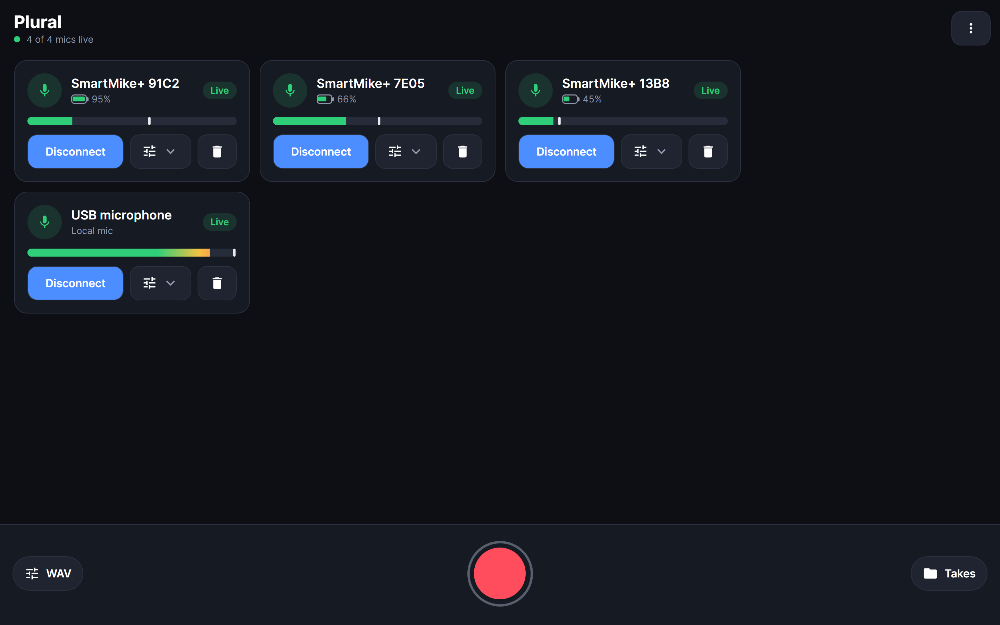

# Plural

**Record several microphones at once, each on its own track, all in sync.** Press Record once and every mic starts together;
press Stop and the take is ready.

Plural started as a way to bring the discontinued **Sabinetek SmartMike+** wireless mics back to life. Their app is gone,
so Plural talks to the mics directly over Bluetooth. It also records the mics you already have (built-in, USB, wired or
Bluetooth headset), and it can link several phones and computers so they record one take together.

**Website:** [getplural.net](https://getplural.net) · **Download:** [latest release](https://github.com/zealofzebras/plural/releases)

> Plural is an independent project. It is not made by, endorsed by or affiliated with Sabinetek. SmartMike is a trademark of its owner.

## What you can do with it

- **Record a podcast or interview** with a mic on every guest, each voice on its own track for easy editing.
- **Use your SmartMike+ mics again**: connect two, three or more at once, alongside any other mic you have.
- **Stay in sync, even in long recordings**: every track lines up with the others and with your video.
- **Pick your format**: WAV, M4A or MP3 (one file per mic), MKA (one file with a track per mic), or video with sound (MKV or MP4).
- **Mix as you go**: a volume slider, mute button and level meter for each mic, plus battery level, mic gain and headphone volume
  for SmartMike+ mics.
- **Use the mics in other apps**: on Windows, send a mic to a virtual audio cable so Zoom, OBS or your editing software sees it as a microphone.
- **Record on several devices together**: start and stop Plural on other phones and computers over Wi-Fi or Bluetooth, and
  collect all their files into one take.

## Getting started

1. **Pair your SmartMike+ mics** in your phone's or computer's Bluetooth settings. Plural only shows mics that are already paired.
2. **Open Plural** and add your mics. Each one gets its own card with a level meter, and other mics you have (USB, built-in) can be added too.
3. **Press the red Record button.** Every mic starts at the same moment. Press it again to stop; your recording is under **Takes**.

## Where it runs

| Device | Status |
|---|---|
| Windows 10 and 11 | Ready to use; tested with SmartMike+ mics |
| Android 8.0 and newer | Works on phones; newer features are still being tested |
| Mac | Available, but not yet tested on a Mac |
| iPhone and iPad | In progress; SmartMike+ support depends on Apple's accessory rules |
| Linux | Planned |

## Help and feedback

Found a problem or have an idea? [Open an issue](https://github.com/zealofzebras/plural/issues). We especially welcome
reports from Mac, iPhone and Android users, since those are the devices we can test least.

## For developers

Plural is open source. How it works, how to build it, the command-line version (which an AI assistant can also control) and how to contribute
are all in the **[developer guide](DEVELOPMENT.md)**.
